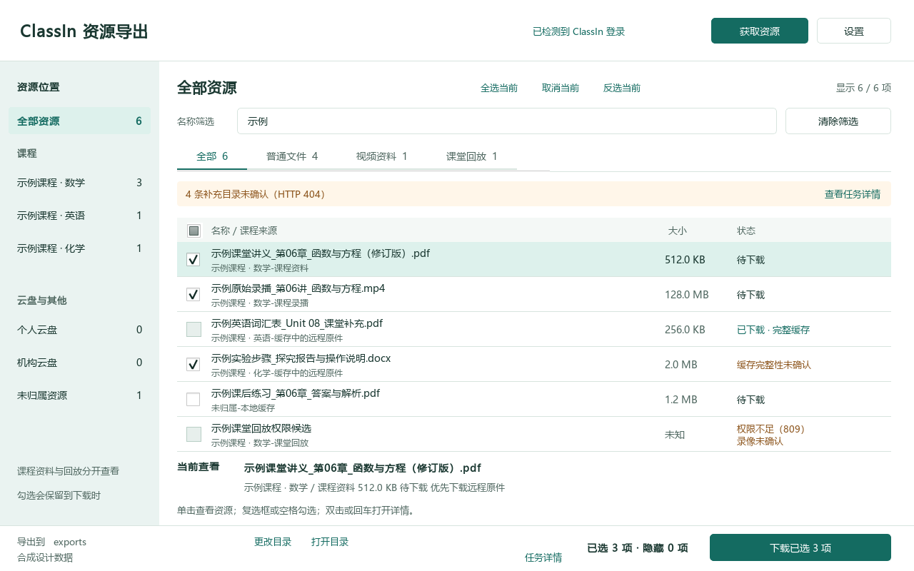

# ClassInExporter

基于 Python / PySide6 Qt 的 ClassIn 资源导出工具。读取本地的 ClassIn 会话，按课程整理普通文件、视频资料和可用课堂回放，优先下载远程原件，必要时回退经确认完整的缓存。

本项目使用 ChatGPT 6.1-sol 辅助开发。



## 安装与运行

### 使用 Windows 打包版

打包版可按下方构建说明在本地构建。将生成的 `ClassInExporter-0.4.2-win64.zip` 解压后运行 `ClassInExporter/ClassInExporter.exe`。默认导出到同目录下的 `exports`。

### 从源码运行

需要 64 位 Python 3.11 或更新版本。

双击 `run.bat` 运行。或为本项目创建独立环境后运行：

```powershell
py -3.11 -m venv .venv
.\.venv\Scripts\python.exe -m pip install -r requirements.txt
.\.venv\Scripts\python.exe run.py
```

## 使用方法

1. 打开 ClassIn 客户端，并登录需要导出资源的账号。
2. 打开 ClassInExporter，等待后台登录检测完成，点击“获取资源”。
3. 在左侧选择课程 / 云盘，勾选需要下载的资源。
4. 点击“下载已选”批量下载。

## 分析结论与开发入口

当前实现结合公开前端请求定义、客户端导出符号与指令、实际响应以及下载样本验证。主要链路为：

```text
当前登录会话 → 课程 / 云盘索引 → 单元和活动详情
             → 统一资源模型 → 原件地址刷新 → 下载及完整性验证
```

- `classin_exporter/session.py`：按安装文件的导出与 getter 指令特征定位当前会话，处理服务域名、签名、登录一致性与线程 transport。
- `classin_exporter/discovery.py`：课程、云盘、活动分页及资源聚合。
- `classin_exporter/lms_material.py`、`lms_record.py`、`lms_homework.py`：资料、录播与作业附件适配。
- `classin_exporter/resources.py`、`grouping.py`：统一资源结构、稳定标识及输出目录。
- `classin_exporter/downloader.py`、`cache.py`、`download_history.py`：远程原件、标准 HLS、Qt 缓存完整性、已下载记录及取消清理。
- `classin_exporter/gui.py`、`gui_workspace.py`、`gui_views.py`：后台调度与中文 Qt 课程目录界面。

详细的复现步骤、认证和签名规则、API 请求字段、响应结构、分页及验证边界见 [API.md](API.md)。

### 关于官方

[官方 Python SDK](https://github.com/EeoApiSupport/classin-sdk-py) 和 [机构 API 文档](https://docs.eeo.cn/api/zh-hans/) 面向已开通 API 的机构，需要机构 SID 和密钥。与本项目的个人客户端登录会话不是同一认证来源。
详见 [API.md 中的官方接口比较](API.md#官方-sdk-与机构-api)。

## 构建

在 Windows x64 和 Python 3.11 环境中，从项目根运行：

```powershell
.\build\build.ps1
```

脚本会自动创建本地 `.venv`、安装 `requirements-build.txt`、检查配置并执行离线自检，随后构建 EXE、运行冻结程序自检，生成 ZIP 和 SHA-256 文件。已有依赖时使用 `-SkipDependencyInstall`；只执行前置检查时使用 `-VerifyOnly`。

```powershell
.\build\build.ps1 -SkipDependencyInstall -VerifyOnly
.\build\build.ps1 -SkipDependencyInstall
```

输出位于 `dist/ClassInExporter/`。

如果便携目录中已有导出文件，脚本会停止覆盖构建。可使用 `-OutputDirectory dist/rebuilt` 将新便携版输出到另一目录，保留已有资源。

## 许可证与版权

Copyright (c) 2026 **3093FengMing**。

本项目采用 [PolyForm Noncommercial License 1.0.0](LICENSE)，属于源码可用的非商用许可。允许符合许可的非商用使用、修改和再发布；分发时必须保留完整许可条款或许可链接，以及 [NOTICE](NOTICE) 中的 Required Notice。

第三方依赖保留其各自版权与许可证；本项目许可不授予 ClassIn 服务、账号或课程资源的访问及内容版权。导出资源应符合本人已有的访问与使用权限。
